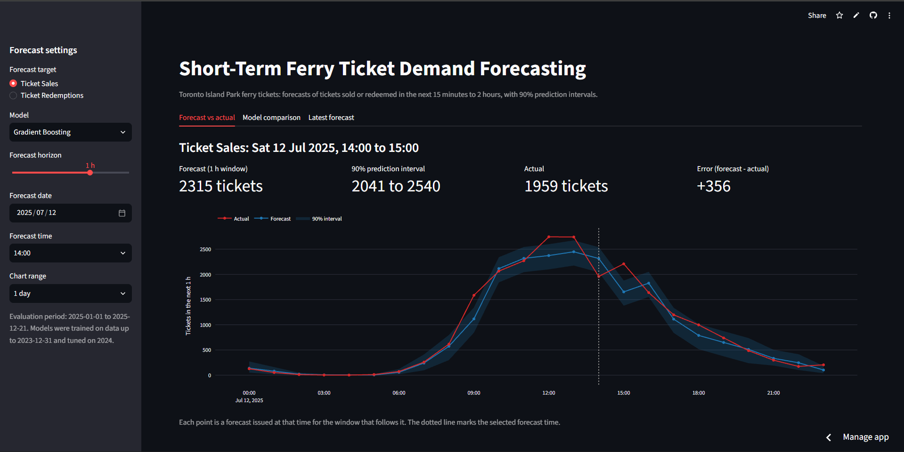
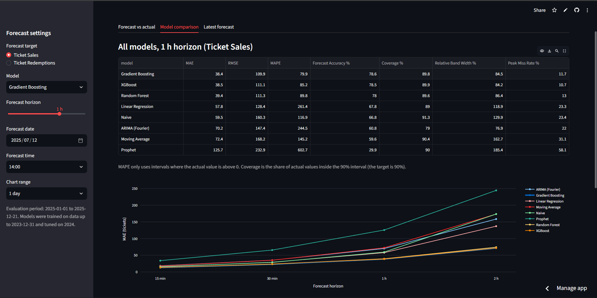

# 🚢 Toronto Island Ferry Ticket Demand Forecaster

A short-term forecasting system built using Python and Streamlit that predicts **how many tickets will be sold and redeemed in the next 15 minutes, 30 minutes, 1 hour and 2 hours** for the Toronto Island Park ferry, with a 90% prediction interval on every forecast.

This project combines:

- 📊 Time-series preparation of 15-minute ticket records (2015 to 2025)
- 🤖 Statistical and machine-learning forecasting models
- 🧪 Strict chronological validation on a held-out test year
- 📈 Interactive dashboard with prediction intervals
- 🚨 Operational KPIs for scheduling, staffing and crowd management

---

## 🚀 Features

### 📌 Forecasting Models
The system benchmarks eight forecasting methods for every target and horizon:

- Naive (repeat the last window)
- Moving Average (recent 2-hour rate)
- Linear Regression
- Random Forest Regressor
- Gradient Boosting Regressor
- XGBoost
- ARIMA(2,0,1) with Fourier seasonality
- Prophet (flat trend, seasonality-aware)

It also supports:

- ✅ Model-vs-model comparison
- ✅ 90% prediction intervals calibrated on validation data
- ✅ Forecasts for 15 min, 30 min, 1 h and 2 h windows

---

## 🧮 Predictive Features Used

The machine-learning models use 14 features, all built from information available at the forecast time:

- Lag features (t-1, t-2, t-4, t-8, in 15-minute steps)
- Rolling mean, standard deviation and maximum over the last hour and the last day
- Calendar effects: hour of day, day of week, month and a weekend indicator

Missing 15-minute slots are filled with 0 tickets. Gaps of 12 hours or longer are masked and excluded.

---

## 🧪 Validation & Evaluation

### Validation Method
- Strict chronological split: training through 2023, tuning on 2024, testing on 2025 (never seen in training)
- About 8,400 hourly forecast origins scored per target and horizon in the test year
- Multi-horizon scoring at 15 min, 30 min, 1 h and 2 h

### Metrics Computed
- MAE (Mean Absolute Error)
- RMSE (Root Mean Squared Error)
- MAPE (Mean Absolute Percentage Error, only where tickets were sold)
- Horizon-wise error

### Operational KPIs
- Forecast Accuracy (%)
- Error Drift (percentage points)
- Peak Miss Rate (%)
- Confidence Band Width (relative %)
- Forecast Lead Time (minutes)

---

## 🖥️ Dashboard Tabs

### 📊 Forecast vs Actual
- Forecast, 90% interval and actual value for the chosen date, time and horizon
- Four number cards: forecast, interval, actual and error
- Chart over 1, 3 or 7 days

### 🧪 Model Comparison
- Table of all models for the selected horizon
- MAE by horizon line chart
- Key performance indicators, with the horizon-dependent columns following the slider

### 🔮 Latest Forecast
- Forecast for all four horizons from the last record in the data
- Bar chart with 90% interval whiskers

---

## 🛠️ Technologies Used

### Programming Language
- Python

### Libraries & Frameworks
- Streamlit
- Pandas
- NumPy
- Scikit-learn
- XGBoost
- Statsmodels
- Prophet
- Plotly
- Joblib

---

## 📂 Project Structure

```bash
├── app.py                    # Streamlit dashboard (main entry point)
├── train.py                  # Full training and evaluation pipeline
├── requirements.txt
├── README.md
├── .gitignore
├── data/
│   └── Toronto_Island_Ferry_Tickets.csv
├── src/
│   ├── config.py             # Horizons, split dates, KPI settings
│   ├── data_prep.py          # Time-series preparation
│   ├── features.py           # Feature engineering and targets
│   ├── models.py             # Baselines, ML models, prediction intervals
│   ├── timeseries_models.py  # ARIMA and Prophet
│   └── evaluate.py           # Metrics and KPIs
├── artifacts/                # Results used by the dashboard
└── models/                   # Saved ML models with interval calibrators
```

---

## ⚙️ Installation

### 1️⃣ Clone the Repository

```bash
git clone https://github.com/Sheikh-13/short-term-ferry-ticket-demand-forecasting-and-predictive-decision-support-system.git
cd short-term-ferry-ticket-demand-forecasting-and-predictive-decision-support-system
```

---

### 2️⃣ Install Dependencies

```bash
pip install -r requirements.txt
```

---

### 3️⃣ Run the Application

```bash
streamlit run app.py
```

> ⚡ The trained models and forecasts are included, so the dashboard opens immediately.

### 🔁 Retrain (optional)

```bash
python train.py
```

> ⏱️ Retraining takes about 10 minutes and rebuilds every file in `artifacts/` and `models/`.

---

## 📦 Requirements

```txt
numpy==2.4.4
pandas==3.0.2
scikit-learn==1.8.0
xgboost==3.4.1
statsmodels==0.15.0
prophet==1.5.0
streamlit==1.66.1
plotly==7.1.0
joblib==1.5.3
```

---

## 📊 Forecasting Workflow

```text
Raw Ticket Records (CSV, 15-minute intervals)
      ↓
Complete 15-Minute Series (short gaps = 0, gaps of 12 h+ masked)
      ↓
Feature Engineering (lags, rolling stats, calendar)
      ↓
Training (through 2023) → Validation (2024) → Test (2025)
      ↓
Eight Models per Target and Horizon
      ↓
Prediction Intervals (calibrated on validation errors)
      ↓
KPI Calculation (accuracy, peak miss, band width, lead time)
      ↓
Dashboard Visualization
```

---

## 🎯 Forecast Output

For each selected date, time and horizon, the system shows:

- 📈 Tickets sold or redeemed in the next window (point forecast)
- 📏 90% prediction interval
- ✅ Actual value and error (for 2025 test dates)
- 🚨 Peak miss rate and band width, by model

---

## 📸 Snapshots

<div align="center">

### **Forecast vs Actual**
*Forecast, 90% interval and actual value for a chosen hour*



### **Model Comparison**
*All eight models and the KPI table*



### **Latest Forecast**
*Forecast for all four horizons from the last record*


</div>

---

## 📚 Educational Purpose

This project was developed as an internship project.

It demonstrates practical applications of:

- Time-Series Analysis
- Statistical & Machine-Learning Forecasting
- Chronological Model Validation
- Prediction Intervals and Calibration
- Operational KPI Design
- Interactive Dashboard Development

---

## ⚠️ Disclaimer

This project is developed for educational and research purposes only.

Forecasts are statistical estimates based on historical patterns and should complement, not replace, operational judgment. The 2025 results are a backtest on held-out data, not live forecasts. Use real ticketing feeds and operational limits before relying on this tool for live decisions.

---

## 👨‍💻 Author

Developed by **Sheikh Tauheed**

Internship Project -Data Science

**GitHub**: [Sheikh-13](https://github.com/Sheikh-13)

---

## ⭐ Future Improvements

- Weather, holiday and event data as additional features
- Live ticket feed in place of the static CSV
- Automated retraining cadence
- Supervised pilot in the peak season
- Deployment on Streamlit Community Cloud
